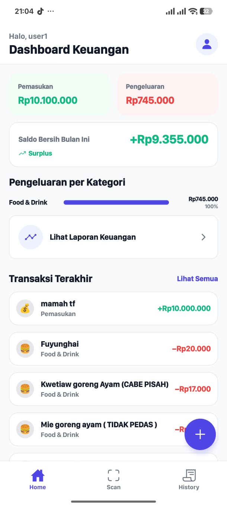
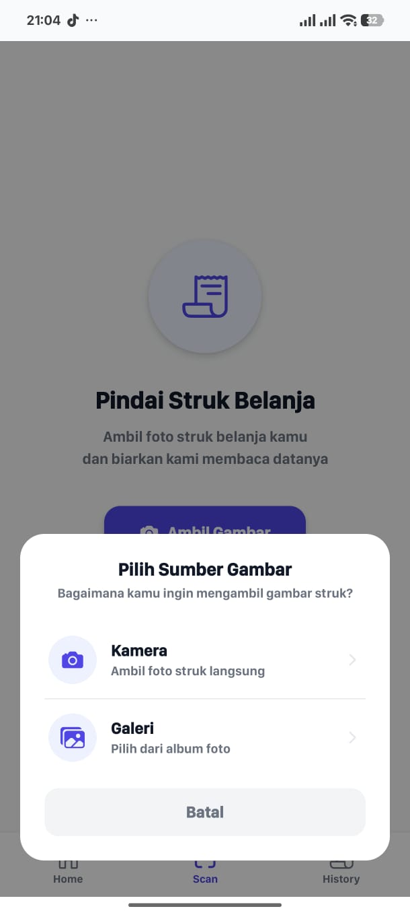
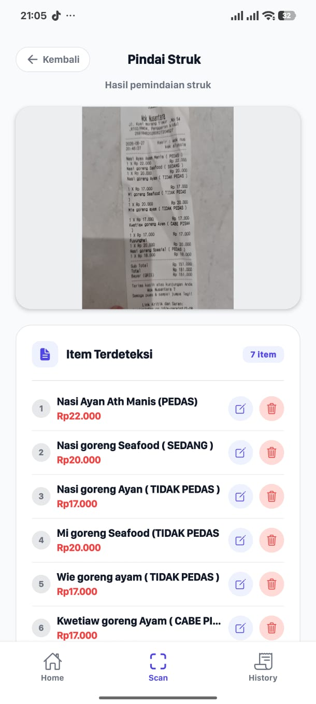
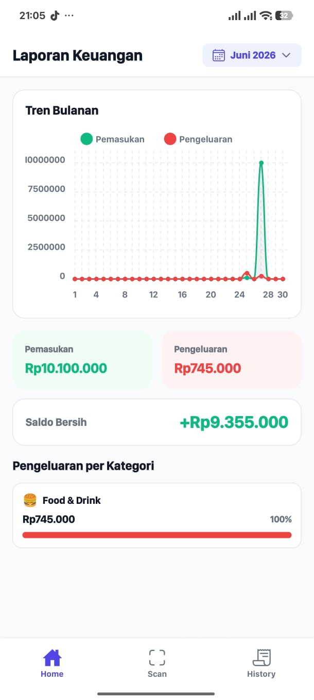
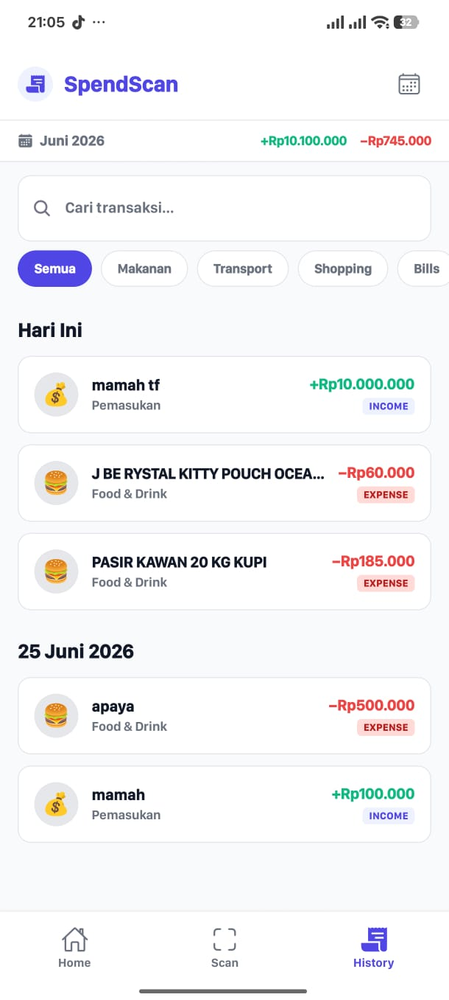
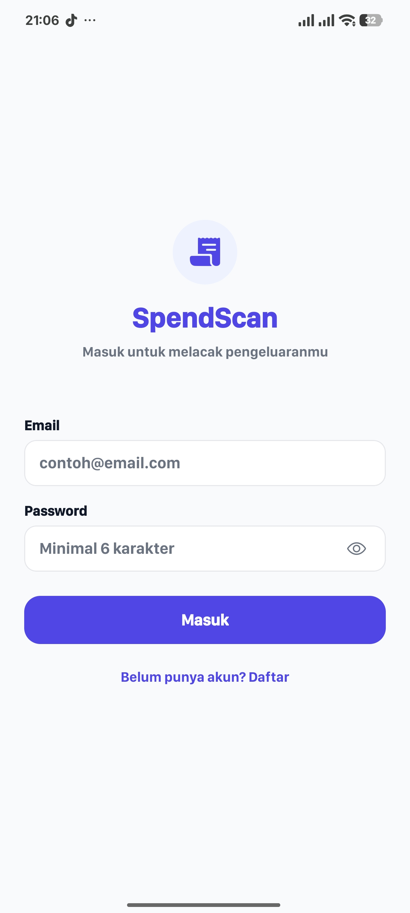

# SpendScan 🧾

**Smart Receipt Expense Tracker** — A mobile app for recording expenses and income, scanning receipts with AI-powered OCR, and viewing financial reports.

Built with React Native (Expo SDK 58) + Node.js/Express backend + Supabase database + Google Gemini Vision for receipt parsing.

---

## 📁 Repository Layout

This repo holds **both** halves of the project, in two folders instead of two repos:

```text
SpendScan/
├── App.js, src/, assets/, app.json   # Expo mobile app (this is the project root)
└── backend/                          # Express API, its own package.json + node_modules
```

Why split by folder rather than merge into one package:

- **Vercel needs its own Root Directory.** The Vercel project points at `backend`, so only that folder's dependencies get installed on the server — not the ~1 GB Expo tree.
- **Metro scans the root project.** Server-only deps (`express`, `pg`, `busboy`, `tesseract.js`) stay out of the mobile bundle's resolution graph.
- **The backend is its own process.** `node src/server.js` listens on a port; it can't live inside a `package.json` whose main script is `expo start`.

Two folders, one repo: shared commit history, one clone, and each half still deploys independently.

---

## ✨ Features

- **💰 Manual Tracking** — Add expenses and income with categories
- **🏦 Bagi Saldo (optional)** — Split money into custom pockets (name/icon/color, your own naming). Pockets are **optional** on every transaction, income or expense.
- **🧾 Pocket Detail** — Tap a pocket card to see every transaction tagged to it
- **📷 Receipt Scanning** — Take a photo of a receipt; AI extracts items automatically
- **🧠 AI-Powered Parsing** — Google Gemini Vision (`gemini-3.6-flash`) returns structured JSON (items, merchant, date) straight from the image
- **📋 Item Review** — Edit, delete, or add items before saving
- **📊 Dashboard** — Total Saldo headline, monthly income/expense cards, per-category or per-pocket breakdown
- **📈 Report Screen** — Interactive line chart with daily trends and month picker
- **🔍 Transaction History** — Search, filter by category or pocket, filter by month
- **🔐 Authentication** — Register/login/logout with JWT in SecureStore, auto-logout on 401
- **☁️ Cloud Storage** — Receipt images stored in Supabase Storage

---

## 💰 Balance Model (v1.3.0)

Two concepts, deliberately kept apart:

```text
Total Saldo   = Σ income − Σ expense                      (read-only, never edited by hand)
Pocket saldo  = base_balance + Σ tagged income − Σ tagged expense
Unallocated   = Total Saldo − Σ pocket saldo              (validation only, not a card)
```

- **Total Saldo is read-only.** To raise it, record real income (e.g. "Saldo Awal").
- **Pocket saldo is derived, not mutated.** Edits and deletes on transactions self-correct the number.
- **Pockets are optional.** Untagged transactions still count toward Total Saldo; when Bagi Saldo is on they are stored as `category = 'Lainnya'` and appear in no pocket.
- **Setting a pocket saldo above the remaining Total Saldo is rejected.** Existing over-allocated data is never punished, only new increases are blocked.
- **Deleting a pocket** drops the card and untags its transactions (`ON DELETE SET NULL`). Total Saldo does not change.

---

## 🛠 Tech Stack

### Mobile App
| Library | Purpose |
|---------|---------|
| React Native + Expo SDK 58 | Cross-platform mobile framework |
| React Navigation | Tab + Stack navigation |
| @expo/vector-icons | Icon library |
| react-native-chart-kit | Line charts for reports |
| expo-image-picker | Camera & gallery access |
| expo-file-system | File reading for OCR upload |
| @infinitered/react-native-mlkit-text-recognition | On-device OCR (first pass, before AI) |
| expo-secure-store | JWT token storage |
| date-fns | Date formatting |

### Backend
| Library | Purpose |
|---------|---------|
| Node.js + Express (v5) | API server |
| Supabase (PostgreSQL) | Database |
| Supabase Storage | Receipt image storage |
| **Google Gemini Vision** | **Image-to-JSON receipt parsing** |
| OpenAI SDK | LLM API client (Gemini OpenAI-compatible endpoint) |
| jsonwebtoken | JWT authentication |
| bcryptjs | Password hashing |

### Deployment
| Service | Detail |
|---------|--------|
| **Hosting** | Vercel (free Hobby plan, Express preset) |
| **Production URL** | `https://backend-delta-sand-64.vercel.app` |
| **Deploy command** | `vercel --prod --yes --force` |

> Run the deploy command **from the repo root**. The Vercel project's Root Directory is already set to `backend`, so `vercel --cwd backend ...` fails looking for `backend/backend`.

---

## 📸 Screenshots

<table>
  <tr>
    <td></td>
    <td></td>
    <td></td>
  </tr>
  <tr>
    <td align="center"><em>Dashboard</em></td>
    <td align="center"><em>Scan Receipt</em></td>
    <td align="center"><em>Item Review</em></td>
  </tr>
  <tr>
    <td></td>
    <td></td>
    <td></td>
  </tr>
  <tr>
    <td align="center"><em>Report</em></td>
    <td align="center"><em>Transaction History</em></td>
    <td align="center"><em>Login</em></td>
  </tr>
</table>

---

## 🚀 Getting Started

### Prerequisites

- Node.js 18+
- Expo Go app on your phone (Android/iOS) — for development
- A Gemini API key ([aistudio.google.com](https://aistudio.google.com)) — for receipt scanning
- A Supabase project ([supabase.com](https://supabase.com)) — for database & storage
- Vercel CLI — for backend deployment (optional)

### Quick Install (APK)

Download the latest APK directly on your Android phone:

[⬇️ Download SpendScan APK v1.3.0](https://expo.dev/artifacts/eas/-_6pCSyieKyq0kjP-dyDPWVOyFacEzxMo5KxeoFmL7Y.apk)

Or visit: `https://expo.dev/accounts/naitkomahli/projects/SpendScan/builds`

> The APK connects to the production backend at `https://backend-delta-sand-64.vercel.app`. No setup required.
> This is a `preview` (standalone) build: the JS bundle is frozen inside the APK. Without `expo-updates`, every code change needs a new build + install.

### Run from Source (Development)

```bash
# Clone the repository
git clone https://github.com/Naitkomahli/SpendScan.git
cd SpendScan

# Install mobile dependencies (project root)
npm install

# Install backend dependencies
cd backend
npm install
cd ..
```

### Backend Setup

#### Local Development

1. **Create a `.env` file** in `backend/`:

```env
PORT=3000

# Supabase
SUPABASE_URL=your_supabase_url
SUPABASE_ANON_KEY=your_anon_key
SUPABASE_SERVICE_ROLE_KEY=your_service_role_key

# JWT
JWT_SECRET=your_jwt_secret
JWT_EXPIRES_IN=7d

# LLM (Gemini, OpenAI-compatible endpoint)
LLM_API_KEY=your_gemini_api_key
LLM_BASE_URL=https://generativelanguage.googleapis.com/v1beta/openai/
LLM_MODEL_VISION=gemini-3.6-flash
```

2. **Run the database migrations** in the Supabase SQL Editor, in order:

- `backend/src/db/schema.sql`
- `backend/src/db/migration_pockets.sql`
- `backend/src/db/migration_pockets_v2.sql`
- `backend/src/db/migration_pockets_v3.sql`

3. **Start the backend server**:

```bash
cd backend
node src/server.js
```

#### Deploy to Vercel (Production)

```bash
# Install Vercel CLI
npm install -g vercel

# Set environment variables
echo "your_value" | vercel env add SUPABASE_URL production --yes
echo "your_value" | vercel env add SUPABASE_ANON_KEY production --yes
# ... repeat for all env vars (see table below)

# Deploy from the repo root
vercel --prod --yes --force
```

Production URL: `https://backend-delta-sand-64.vercel.app`

### Run Mobile App (Development)

```bash
# From project root
npx expo start
```

Scan the QR code with Expo Go on your phone. Make sure your phone and laptop are on the same WiFi network.

> 💡 **Development:** The app uses the production Vercel backend by default. If you run the backend locally, update `BASE_URL` in `src/services/api.js` to your laptop's IP (e.g., `http://192.168.1.19:3000/api`).

### Build APK

```bash
# Install EAS CLI
npm install -g eas-cli

# Login to Expo
eas login

# Build APK (preview profile = installable APK)
eas build --platform android --profile preview
```

`.easignore` excludes `backend/` from the build archive, so the mobile build never uploads server code or its dependencies.

---

## 📂 Project Structure

```text
SpendScan/
├── App.js                      # Entry point with ErrorBoundary + AuthProvider
├── app.json                    # Expo config (v1.3.0, versionCode 4)
├── eas.json                    # EAS Build profiles
├── .easignore                  # Keeps backend/ out of EAS build archives
├── src/                        # ── MOBILE APP ──
│   ├── components/
│   │   ├── TransactionCard.jsx
│   │   ├── CategoryBadge.jsx
│   │   ├── PocketCard.jsx      # Name + saldo, pressable
│   │   ├── EmptyState.jsx
│   │   └── Skeleton.jsx        # Shimmer loading placeholders
│   ├── constants/
│   │   ├── colors.js
│   │   ├── categories.js
│   │   └── pockets.js          # Icon/color presets for pockets
│   ├── contexts/
│   │   └── AuthContext.js      # Auth state + SecureStore
│   ├── data/
│   │   └── mockTransactions.js
│   ├── navigation/
│   │   └── AppNavigator.jsx    # Tabs (Home/Scan/History) + Stack
│   ├── screens/
│   │   ├── HomeScreen.jsx      # Total Saldo, monthly summary, pocket cards
│   │   ├── AddTransactionScreen.jsx
│   │   ├── EditTransactionScreen.jsx
│   │   ├── TransactionListScreen.jsx
│   │   ├── TransactionDetailScreen.jsx
│   │   ├── PocketDetailScreen.jsx  # Transactions tagged to one pocket
│   │   ├── ManagePocketsScreen.jsx # CRUD pockets + set saldo
│   │   ├── LoginScreen.jsx
│   │   ├── ProfileScreen.jsx   # User info, logout, Bagi Saldo toggle
│   │   ├── ReportScreen.jsx    # Line chart report
│   │   └── ScanScreen.jsx      # Camera/gallery + AI scan + item review
│   ├── services/
│   │   ├── api.js              # Fetch wrapper (auto-attaches JWT)
│   │   ├── authService.js
│   │   ├── transactionService.js
│   │   ├── pocketService.js
│   │   └── ocrService.js       # On-device ML Kit OCR
│   └── utils/
│       ├── formatCurrency.js
│       └── receiptParser.js    # Turn raw OCR text into candidate items
├── backend/                    # ── EXPRESS API ──
│   ├── .env
│   ├── vercel.json             # Route all requests to Express
│   ├── package.json            # Own dependencies
│   └── src/
│       ├── server.js           # Express listen (local dev)
│       ├── app.js              # Express app (Vercel entry)
│       ├── config/supabase.js
│       ├── controllers/        # auth, transaction, pocket, receipt
│       ├── services/llmParser.js  # Gemini Vision receipt parsing
│       ├── middleware/         # auth.js, errorHandler.js
│       ├── routes/             # auth, transactions, pockets, receipts
│       └── db/                 # schema.sql + migration_pockets*.sql
└── docs/
    ├── PRD.md                  # Product requirements (source of truth)
    ├── TECHNICAL.md            # Full technical overview
    ├── STORYBOARD.md
    ├── PORTFOLIO.md
    ├── MEMORY.md               # Build/session notes
    └── screenshots/
```

---

## 🔌 API Endpoints

| Method | Endpoint | Description | Auth Required |
|--------|----------|-------------|:---:|
| POST | `/api/auth/register` | Register new user | ❌ |
| POST | `/api/auth/login` | Login user | ❌ |
| GET | `/api/transactions` | Get all transactions | ✅ |
| GET | `/api/transactions/:id` | Get transaction by ID | ✅ |
| POST | `/api/transactions` | Create transaction | ✅ |
| PUT | `/api/transactions/:id` | Update transaction | ✅ |
| DELETE | `/api/transactions/:id` | Delete transaction | ✅ |
| POST | `/api/receipts/scan` | Upload & scan receipt | ✅ |
| GET | `/api/pockets` | List pockets + `enabled` flag | ✅ |
| POST | `/api/pockets` | Create pocket | ✅ |
| PATCH | `/api/pockets/:id` | Update pocket (incl. `balance`) | ✅ |
| DELETE | `/api/pockets/:id` | Delete pocket (untags transactions) | ✅ |
| PATCH | `/api/pockets/settings` | Toggle Bagi Saldo | ✅ |
| GET | `/api/pockets/:id/transactions` | Transactions tagged to a pocket | ✅ |

All responses follow `{ success: boolean, message: string, data: any }` format.

---

## 🔑 Environment Variables

### Backend (`backend/.env`)

| Variable | Required | Description |
|----------|:--------:|-------------|
| `PORT` | ❌ | Server port (default: 3000) |
| `SUPABASE_URL` | ✅ | Supabase project URL |
| `SUPABASE_ANON_KEY` | ✅ | Supabase anonymous key |
| `SUPABASE_SERVICE_ROLE_KEY` | ✅ | Supabase service role key |
| `JWT_SECRET` | ✅ | Secret for signing JWT tokens |
| `JWT_EXPIRES_IN` | ❌ | Token expiry (default: 7d) |
| `LLM_API_KEY` | ✅ | Gemini API key |
| `LLM_BASE_URL` | ❌ | Gemini OpenAI-compatible base URL |
| `LLM_MODEL_VISION` | ❌ | Vision model for receipt scanning (default: `gemini-3.6-flash`) |

---

## ✅ Testing Checklist

- [x] Register, login, logout
- [x] Token persists across app restarts
- [x] Add income & expense transactions
- [x] Dashboard shows Total Saldo + monthly income/expense
- [x] Category breakdown with progress bars
- [x] Pocket cards show name + saldo; tap opens pocket detail
- [x] Set pocket saldo; over-allocation rejected
- [x] Transaction list with month filter
- [x] Search & category/pocket filter
- [x] Edit & delete transactions
- [x] Report screen with line chart
- [x] Scan receipt → AI Vision → item review
- [x] Edit/delete/add items in review screen
- [x] Batch save multiple transactions from one receipt
- [x] Profile screen with user info & logout

---

## 📥 Download APK

Latest build (v1.3.0, versionCode 4):

```text
https://expo.dev/artifacts/eas/-_6pCSyieKyq0kjP-dyDPWVOyFacEzxMo5KxeoFmL7Y.apk
```

Or visit: [Expo Builds Dashboard](https://expo.dev/accounts/naitkomahli/projects/SpendScan/builds)

---

## 📄 License

This project is for educational and portfolio purposes.

---

## 👤 Author

**Ilham Oktian Ramadhan** — Mobile App Developer & Project Owner

---

## 🙏 Acknowledgments

- React Native & Expo teams
- Supabase for backend infrastructure
- Google Gemini for the vision API
- Vercel for free hosting
